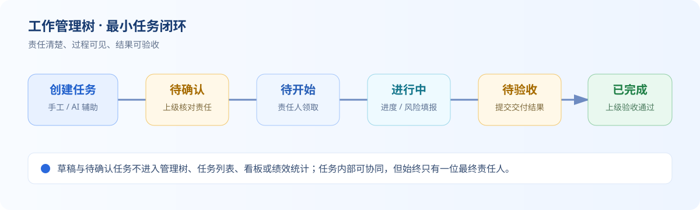
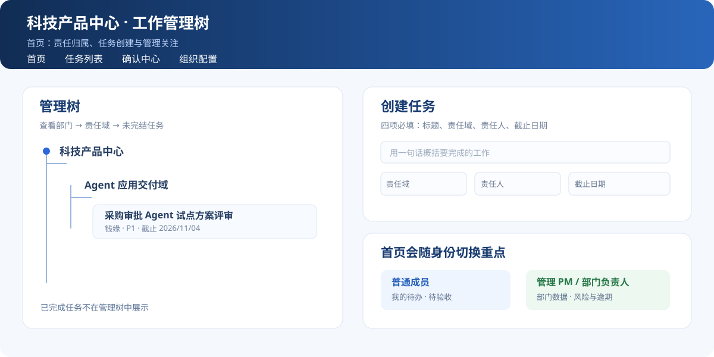
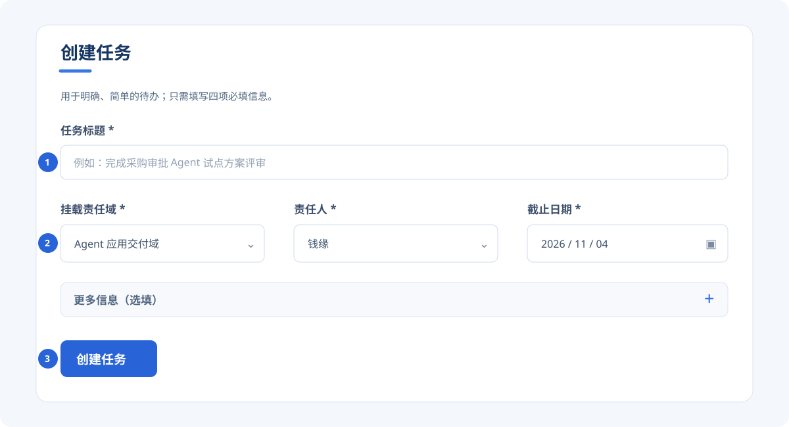
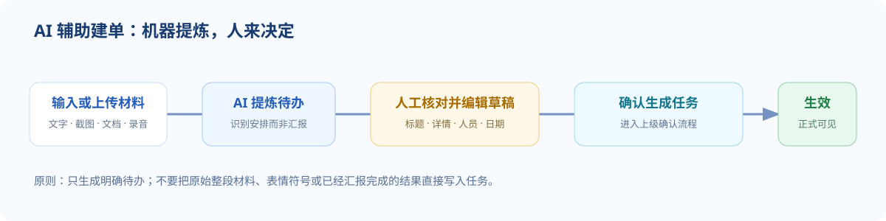
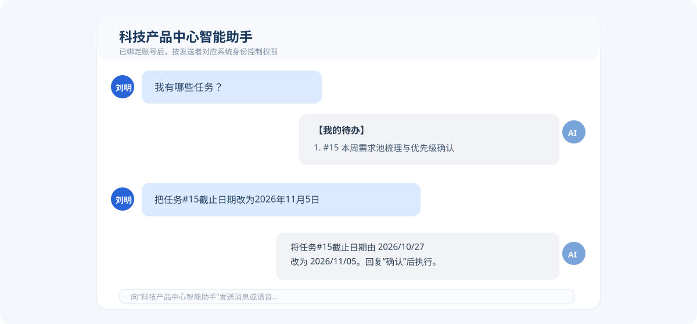
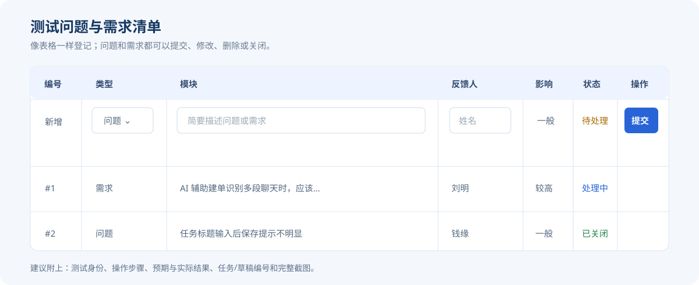

# 工作管理树测试人员操作手册

> 版本：试点版 V1.1（持续更新）<br>
> 适用对象：科技产品中心试点成员、管理 PM、部门负责人及协助测试同事。<br>
> 在线阅读：`http://43.106.15.183:5100/manual`<br>
> 问题与需求清单：`http://43.106.15.183:5100/test-issues`

## 1. 产品要解决什么问题

工作管理树不是又一个“填表工具”，而是让部门日常工作形成**责任清楚、进展可见、结果可验收、过程可追溯**的共同工作台。

目前很多工作会在会议、飞书对话和口头沟通中被安排，但容易出现“谁负责不明确、何时完成没人持续跟、完成质量无法判断”的情况。系统用一棵管理树承接责任归属，把每一项工作固定到：

> **一个责任域 + 一位最终责任人 + 一个截止日期 + 可验收结果**

任务内部可以有多人协作，但系统只向管理者呈现一位最终责任人；具体协同由责任人组织。

### 1.1 第一阶段目标：让大家愿意用、用得起来

本阶段服务于科技产品中心试点及后续小范围部门推广，核心目标是：

1. **快速建单**：手工创建只要求“标题、责任域、责任人、截止日期”四项；会议纪要、截图、文档和录音可由 AI 辅助提炼。
2. **形成最小闭环**：创建 → 上级确认 → 责任人执行/填报 → 上级验收。
3. **减少追问成本**：责任人、管理 PM 与部门负责人在首页看各自最需要关注的信息。
4. **让数据可用于管理**：沉淀任务数量、时效、风险、工时、复杂度、完成质量等基础数据，为后续绩效分析提供依据。
5. **验证交互方式**：网页与“科技产品中心智能助手”都能完成高频操作，测试哪种方式更适合真实工作。

### 1.2 三阶段目标与推广路径

| 阶段 | 覆盖范围 | 阶段目标 | 通过标准 | 当前测试人员最应关注什么 |
| --- | --- | --- | --- | --- |
| **第一阶段：科技产品中心试点** | 科技产品中心 | 验证“责任域 + 单一责任人 + 截止日期 + 确认验收”是否能成为日常工作的最小闭环；验证网页、AI 建单和飞书助手是否真的省事。 | 成员能在不依赖管理员代操作的情况下完成建单、推进、验收；管理者能发现逾期和风险；任务数据基本可信。 | 功能是否好理解、建单是否足够快、AI 是否可靠、权限和提醒是否正确；优先反馈阻碍日常使用的问题。 |
| **第二阶段：小范围部门复制** | 选择若干业务特征不同的部门 | 将已验证的机制做成可配置、可复用能力：各部门可维护自己的责任域、成员、模板、确认关系和数据看板，同时保持操作简单。 | 新部门可用配置而非开发完成上线；不同部门的任务数据可按统一口径汇总；不因新增字段或流程导致使用率下降。 | 哪些规则必须因部门而异，哪些应保持统一；责任域、模板、提醒、AI 识别在本部门是否准确；是否存在不必要的复杂配置。 |
| **第三阶段：公司级推广** | 全公司 | 建立统一的任务协同与管理数据底座，让跨部门事项有清晰归属、可追溯闭环和可比较的管理数据。 | 组织、权限、数据隔离、审计、容量和稳定性满足公司级使用；管理层能查看可信的跨部门进展与风险；培训和支持成本可控。 | 跨部门责任划分、数据权限、标准口径、批量运营和异常处理；不要以“增加复杂项目流程”替代真实的推广问题。 |

> 三个阶段都坚持同一原则：**先让用户自然地完成工作，再逐步沉淀管理数据。** 是否覆盖专业项目管理、WBS、甘特图等场景，属于更远期决策，应基于真实使用数据单独评估，不默认纳入这三阶段。

### 1.3 本阶段明确不追求什么

为避免流程过长、字段过多而影响使用，本阶段**不把系统做成专业项目管理工具**：

- 不要求创建项目、WBS、甘特图、资源计划、里程碑等复杂对象；如需管理一个项目，可先把项目作为责任域管理。
- 不强制每次填写详细工时、过程文档或复杂审批；“更多信息”均可后补。
- 不以任务数量直接衡量个人绩效；任务难度、时长、类型、质量和时效需要结合看。

### 1.4 试点人员最值得反馈什么

请优先提出能帮助后续推广的建议，而不只是界面偏好：

| 值得反馈 | 举例 |
| --- | --- |
| 让建单更快 | “这个必填字段对日常任务没有价值，建议改为选填/后补。” |
| 让责任更清楚 | “这个场景无法准确选择责任域/责任人，需要怎样的提示或规则？” |
| 让闭环更顺畅 | “提交进度后不知道下一步谁处理、何时能看到结果。” |
| 让 AI 更可靠 | “AI 把汇报结论误建为新任务；正确应提炼后半段的安排。” |
| 让管理数据更有用 | “管理 PM 需要按责任域看到逾期趋势，而不是更多任务卡片。” |

不建议把“希望加入完整项目管理、更多层级审批、更多强制字段”作为第一阶段默认方案；请先说明它解决的真实问题、使用频率和不做的风险。

提出建议时，也请标注它主要服务哪个阶段：**试点体验**、**部门复制**或**公司级治理**。这能帮助团队避免把后期治理能力过早压到第一阶段用户身上。

## 2. 访问与测试准备

### 2.1 系统入口

- 网页地址：`http://43.106.15.183:5100`
- 在线手册：`http://43.106.15.183:5100/manual`
- 测试问题/需求清单：`http://43.106.15.183:5100/test-issues`
- 飞书共享机器人：**科技产品中心智能助手**。

首次访问网页会要求输入访问账号和密码，请向测试组织人获取。当前为测试环境，请只录入测试任务或已获允许的业务信息；不要上传密码、身份证号、客户隐私、合同原件等敏感材料。

### 2.2 两种身份测试方式

| 方式 | 适用场景 | 使用方法 |
| --- | --- | --- |
| 演示身份切换 | 单人快速验证不同角色页面和权限 | 网页右上角“演示身份（仅测试）”下拉框选择成员。 |
| 飞书真实身份 | 多人联调、机器人交互、提醒验证 | 测试人员先向机器人发消息，管理员在网页完成飞书成员绑定。 |

> 演示身份仅用于测试展示；飞书机器人会按照“发送消息的飞书账号 → 已绑定系统成员”识别真实用户身份和权限。

### 2.3 角色与边界

| 角色 | 主要可做事项 |
| --- | --- |
| 任务责任人 | 查看本人任务、开始、填报进度/风险、提交验收、查看详情。 |
| 直属上级/确认人 | 确认或驳回新任务、确认或驳回进度、验收下属任务。 |
| 管理 PM | 查看部门任务数据、维护授权范围内任务，处理管理类事项。 |
| 部门负责人 | 查看全局数据与绩效分析，处理管理确认事项。 |
| 管理员 | 维护岗位、成员、直属上级、飞书绑定、例行模板和确认代理。 |

## 3. 先看这一张图：任务如何闭环



关键原则：

- **草稿和待确认任务不是正式任务**，不会进入管理树、任务看板/数据看板、正式任务列表和绩效统计。
- 责任人只负责推进和提交；上级/确认人负责确认和验收，不能自己验收自己的任务。
- 修改、删除应谨慎：误建或重复可删；已经产生确认、进度或验收记录的事项，应优先保留追溯并补充说明。

## 4. 页面速览



| 页面 | 用途 | 谁最常使用 |
| --- | --- | --- |
| 首页 | 管理树、快速创建/AI 建单；成员看我的待办，管理者看部门数据 | 全员 |
| 任务列表 | 按状态、截止月份、标题关键词查询；查看历史任务 | 全员 |
| 确认中心 | 处理任务确认、进度确认、验收及会话任务草稿 | 确认人/管理者 |
| 组织配置 | 岗位与成员、直属上级、飞书绑定、确认代理、例行模板 | 管理员/管理者 |
| 绩效分析 | 从已确认任务的时效、质量、工时和复杂度看趋势 | 管理 PM/部门负责人 |

首页的“管理树”解决**责任归属**问题；成员首页的“我的待办”解决**今天做什么**问题；管理者首页的数据看板解决**部门哪里有风险**问题。三者用途不同，并不重复。

## 5. 最短操作路径（普通测试人员）

### 5.1 查看自己的待办

1. 打开首页；演示测试时先在右上角切换为自己的身份。
2. 在“我的待办”查看我负责推进、等待我验收和风险/逾期事项。
3. 点击任务标题打开详情，核对责任人、责任域、截止日期、优先级、交付物/验收标准和任务详情。
4. 查历史或定位任务时，进入“任务列表”，组合使用任务状态、截止月份和标题关键词。

**预期结果**：普通成员默认只看到与本人有关的待办和需要本人验收的任务；未确认草稿不可见。

### 5.2 开始、填报、提交验收


1. 找到“待开始”的本人任务，点击“开始”。
2. 任务进行中时点击“反馈”，填写完成比例、已完成事项；有阻塞则补充风险原因与预计完成日期。
3. 进度会进入上级确认；确认后成为有效进度。
4. 工作完成后点击“完成并提交验收”，补充最终交付物链接、文档名称或验收说明。
5. 等待直属上级/确认人验收。

**预期结果**：开始仅责任人可操作；提交后状态变为“待验收”；验收通过后为“已完成”；被驳回后返回“进行中”。

### 5.3 验收下属任务

1. 在首页“等待我验收”或“确认中心”找到事项。
2. 打开详情，核对交付物、进度、风险和历史记录。
3. 选择“验收通过”或“驳回”；驳回必须写清缺什么、如何补齐。

## 6. 创建任务：手工与 AI 两种方式

### 6.1 手工创建（适合明确、简单的任务）



| 字段 | 是否必填 | 填写原则 |
| --- | --- | --- |
| 任务标题 | 是 | 用一句话说明要完成什么，例如“完成采购审批 Agent 试点方案评审”。 |
| 挂载责任域 | 是 | 选择长期业务归属，不要按人员岗位选择。 |
| 责任人 | 是 | 只选择一位最终对结果负责的人。 |
| 截止日期 | 是 | 管理粒度到年月日；点击输入框空白处即可选日期。 |
| 更多信息 | 否 | 类型、优先级、工时、复杂度、详情等按需要展开填写，可后补。 |

创建时会检查相同或相似任务。出现提示时先核对，避免重复建单。新任务进入上级确认，确认前不出现在正式任务视图中。

### 6.2 AI 辅助建单（适合会议纪要、聊天记录或材料）



1. 在首页“AI 辅助建单”输入文字，或点击附件图标添加材料。
2. 支持文字、图片/截图、Word、PDF、文本、录音；可拖拽文件/图片到输入区或直接粘贴截图，单个文件不超过 20MB。
3. 上传识别时请留在页面，等待明显的“识别中”状态完成；不要刷新页面或重复点击生成。
4. 点击“生成任务草稿”。
5. 在草稿卡中核对并可直接修改：标题、详情、责任人、截止日期、责任域、优先级、类型、交付物/验收标准。
6. 确认无误后点击“确认生成任务”；该任务进入确认中心，等待上级确认。

#### AI 识别的正确预期

- 只提炼**明确待办**，不应把整段原文复制成任务；
- “某人汇报已完成结果”不是新任务，“请某人在某日前完成某事”才可能是任务；
- 表情符号、称呼、无关上下文不应出现在标题或详情；
- 责任人、责任域或日期无法判断时，应提示补充，不应臆造；
- 识别错误时直接修改草稿，或删除无效草稿，不要生成错误任务。

**高价值 AI 测试材料示例**：一段先汇报结果、再安排新工作的多人对话；会议截图中带有 @某人和相对日期；一份包含多个待办与非待办背景的会议纪要。


### 6.3 草稿处理

进入“确认中心 → 会话任务草稿”，可以查看网页 AI 与飞书机器人生成的草稿；对每条草稿可编辑补全后生成，或删除无效/重复草稿。

## 7. 飞书智能助手

### 7.1 第一次使用：绑定身份

1. 在飞书中打开共享机器人 **科技产品中心智能助手**。
2. 先发送任意消息，例如“测试绑定”。
3. 告知管理员：网页“组织配置 → 飞书成员绑定 → 新增绑定”中选择系统成员和待绑定账号并保存。
4. 绑定完成后重新向机器人发消息。机器人会按已绑定身份识别权限。

一个飞书账号只能绑定一个系统成员。没有看到待绑定账号时，让员工先给机器人发一条消息后刷新列表。

### 7.2 推荐对话说法



涉及修改、删除、验收、变更责任人或代理等操作时，机器人应先回显拟执行内容；**请确认无误后再回复“确认”**。

| 想做什么 | 推荐说法 |
| --- | --- |
| 查看待办 | “我有哪些任务”“查看我的待办”“今天我要做什么” |
| 查看部门进展（管理角色） | “汇总部门所有任务的进展情况” |
| 填报进度 | “任务#15 完成 80%，阻塞：等待业务确认” |
| 修改截止日期 | “把任务#15截止日期改为2026年11月5日” |
| 修改责任人 | “把任务#15的责任人改为钱缘” |
| 修改任务 | “修改任务#15，交付物改为评审纪要和测试记录” |
| 删除误建任务 | “删除任务#15” |
| 开始/提交验收 | “开始任务#15”“任务#15已完成，提交验收” |
| 验收或驳回 | “验收通过任务#15”“驳回任务#15，原因是缺少测试记录” |
| 设置确认代理 | “将钱缘的确认代理设置为刘明，2026年11月1日至11月5日” |
| 设置定时汇总 | “每天18:00汇总部门任务进展发给我” |

使用建议：尽量带“任务#编号”；使用“这个任务/该任务”前，先让机器人列出待办；日期尽量说完整；机器人理解或回显不准确时，回复“取消”并重新描述。

## 8. 管理人员使用要点

### 8.1 管理树与数据看板

- 管理树：查看“部门 → 责任域 → 未完结任务”的归属关系；已完成任务不在树中展示。
- 首页数据看板：管理 PM、部门负责人关注未完结、已完成、逾期、待验收、责任域分布和责任人负荷。
- 重点关注事项：只展示风险或逾期任务；应优先处理，而不是只看任务数量。

### 8.2 组织配置

进入“组织配置”可维护：

- **岗位与成员**：岗位、成员、所属团队和直属上级；直属上级是任务和进度的默认确认来源。
- **确认代理**：仅用于确认人休假、出差等临时授权；代理人只代为确认，不成为任务责任人；到期应自动失效。
- **飞书成员绑定**：当前绑定、历史绑定、修改、解绑。
- **例行任务模板**：配置每日/每周固定工作；模板只影响后续生成，不篡改历史任务。

当前试点岗位口径：部门负责人、管理 PM、Builder Team leader、Builder、Trainer Team leader、Trainer。岗位用于组织与授权，不改变“一个任务只有一位最终责任人”的规则。

### 8.3 绩效分析怎么看

绩效分析以**已确认生效**的任务为基础。任务数量不等于绩效；进度记录会影响“过程记录覆盖”，但不是任务进入统计的前置条件。

### 8.4 绩效分、绩效点和工时的取数与计算口径

这部分可直接用于向测试人员或管理者说明系统当前的计算逻辑。

#### 1）先看哪些任务会进入当期统计

系统按“考核周期内的**截止日期**”取数：例如选择 `2026年11月`，取截止日期在 `2026/11/01—2026/11/30` 的任务。同时满足以下条件才进入绩效分析：

- 已经通过上级确认并成为正式任务；
- 任务责任人是当前查看的成员；
- 会话草稿、待确认草稿、已删除任务不进入统计；
- 未完成任务会计入计划工作量、工时和过程覆盖，但不会产生“有效交付绩效点”。

> 因此，任务要先确认生效，才会出现在绩效分析里；仅创建草稿不会影响任何绩效数据。

#### 2）绩效点：用工作量和难度平衡任务大小

每条任务先计算“**基准绩效点**”，再根据实际交付质量和时效计算“**有效交付绩效点**”。

`基准绩效点 = 标准工时 × 复杂度系数 × 优先级系数 × 任务类型系数`

| 取数项 | 数据来源 | 当前默认值 / 说明 |
| --- | --- | --- |
| 标准工时 | 任务“更多信息”中的标准工时 | 建议创建任务时填写；未填写时系统按任务类型暂估：例行 2 小时、专项 8 小时、临时 4 小时。 |
| 复杂度 | 任务“更多信息”中的复杂度 | 简单 `1.0`、一般 `1.5`、复杂 `2.0`、重大 `3.0`。 |
| 优先级 | 任务优先级 | P0 `1.5`、P1 `1.2`、P2 `1.0`。 |
| 任务类型 | 任务类型 | 例行任务 `1.0`、专项任务 `1.2`、临时任务 `1.1`。 |

示例：一条 **P1、专项、复杂、标准工时 8 小时** 的任务，基准绩效点为：

`8 × 2.0 × 1.2 × 1.2 = 23.04 点`

这意味着：多个低工时、低复杂度的简单任务，不会天然比一个高复杂度、高工时的任务得分更高。

#### 3）有效交付绩效点：完成后还要看质量和时效

只有任务已完成，且**验收通过**或**有效进度达到 100%**，才会产生有效交付绩效点。

`有效交付绩效点 = 基准绩效点 × 质量系数 × 时效系数`

| 项目 | 当前计算规则 |
| --- | --- |
| 质量系数 | 完成且没有验收驳回记录：`1.0`；有 1 次驳回后完成：`0.8`；有 2 次及以上驳回后完成：`0.6`；未完成：`0`。 |
| 时效系数 | 按期完成：`1.0`；逾期不超过 3 天：`0.9`；逾期 4—7 天：`0.75`；逾期超过 7 天：`0.5`；未完成：`0`。 |
| 完成时间 | 优先取最后一次“验收通过”的时间；没有验收通过记录但有效进度为 100% 时，取任务最后更新时间。 |

> “有效交付工作量”展示的就是当期所有任务的有效交付绩效点之和；它不是简单的已完成任务数量。

#### 4）绩效分：把交付、质量、时效和过程表现合成为 100 分制结果

系统先计算四项业务指标，再按岗位权重加权；团队负责人、管理 PM 和部门负责人还会纳入团队管理指标。

| 指标 | 计算方式 | 用途 |
| --- | --- | --- |
| 交付达成 | `有效交付绩效点 ÷ 基准绩效点 × 100%` | 衡量承诺工作量最终完成了多少。 |
| 按期交付 | `按期完成任务的基准绩效点 ÷ 全部已完成任务的基准绩效点 × 100%` | 衡量完成工作的时效。 |
| 一次质量表现 | `已完成任务的基准绩效点 × 质量系数` 加权平均 | 衡量是否一次验收通过、返工是否较少。 |
| 过程记录覆盖 | `至少有 1 条进度记录的任务数 ÷ 当期任务数 × 100%` | 衡量任务执行过程是否可追溯。 |
| 团队管理 | 下属成员交付达成的平均值 | 仅 Team leader、管理 PM、部门负责人使用；Team leader 看直属/下属链路，管理 PM 和部门负责人看部门成员。 |

`绩效分 = 各指标得分 × 对应岗位权重之和 + 人工校准分`

| 绩效角色 | 交付 | 质量 | 时效 | 过程 | 团队管理 |
| --- | ---: | ---: | ---: | ---: | ---: |
| 普通成员 | 40% | 25% | 20% | 15% | 0% |
| Team leader | 25% | 20% | 15% | 10% | 30% |
| 管理 PM | 20% | 15% | 20% | 15% | 30% |
| 部门负责人 | 0% | 0% | 0% | 0% | 100% |

“人工校准分”用于记录有明确依据的加分或扣分，不替代任务事实数据；校准后会在绩效结果中与原始得分一并展示。

#### 5）工时：标准工时用于计量，实际工时用于复盘

| 工时字段 | 取数 | 是否直接计入绩效分 | 管理用途 |
| --- | --- | --- | --- |
| 标准工时 | 任务创建或补充时填写；缺失时按任务类型暂估 | **是**，通过“基准绩效点”参与工作量计算 | 工作量承诺、负荷预估、不同任务之间的可比性。 |
| 实际工时 | 任务完成后可补录 | **否** | 责任人负荷、标准工时估算偏差和后续模板优化；不是“用时越久分越高”。 |

#### 6）讲解时可强调的三个原则

1. **不按任务数简单排名**：系统用标准工时、复杂度、优先级和类型把工作量拉到同一口径。
2. **完成不等于满分**：验收返工和逾期都会降低有效交付绩效点。
3. **先确保数据真实，再讨论分数**：任务责任人、截止日期、标准工时、复杂度、进度与验收记录越完整，绩效分析越有参考价值。

## 9. 推荐测试清单

| 编号 | 场景 | 操作 | 预期结果 |
| --- | --- | --- |
| T01 | 身份与权限 | 切换演示身份，分别尝试开始、验收、修改 | 页面与按钮随权限变化，越权操作被拒绝。 |
| T02 | 手工建单 | 创建一条包含四项必填信息的任务 | 提示相似任务；新任务进入待确认。 |
| T03 | 确认闭环 | 用责任人上级身份确认任务 | 任务变为待开始并出现在正式视图。 |
| T04 | 执行闭环 | 开始、填报60%、提交验收、上级验收通过 | 状态和历史记录按流程变化。 |
| T05 | 驳回闭环 | 驳回进度或验收 | 必须填写原因，任务返回责任人继续处理。 |
| T06 | AI 文字建单 | 粘贴含背景、汇报与新安排的会议纪要 | 只提取明确待办；草稿可修改/删除。 |
| T07 | AI 图片建单 | 粘贴或拖入聊天截图 | 有识别中提示；能识别发言人与安排关系。 |
| T08 | 飞书绑定 | 新测试人员先发消息，管理员完成绑定 | 后续机器人按该人员权限响应。 |
| T09 | 飞书进度 | 发送“任务#编号 完成80%” | 生成进度确认，不误建新任务。 |
| T10 | 飞书变更 | 变更日期/责任人并回复确认 | 机器人先回显，确认后生效。 |
| T11 | 查询与历史 | 按状态、月份、标题搜索 | 结果与条件一致。 |
| T12 | 数据与绩效 | 用管理身份查看看板和绩效分析 | 风险、逾期、负荷与统计口径符合数据。 |

## 10. 常见问题

### 网页打不开或显示认证提示

确认网址、访问账号密码是否正确；仍无法访问时，截图完整浏览器提示后反馈。不要在群内发送访问密码。

### 演示身份无法切换

先关闭弹窗后再点击右上角下拉框；如仍无响应，使用 `Ctrl + F5` 强制刷新，记录浏览器版本、页面截图和操作时间后反馈。

### 飞书机器人没有回复

确认会话对象是“科技产品中心智能助手”，等待数秒后仅重试一次；仍无回复时提供发送时间、文字/语音内容和截图，并让管理员检查飞书绑定。

### 机器人把操作误判为新建任务

使用“任务#编号 + 动作 + 明确内容”，例如“任务#15完成80%”。不要确认错误回显，回复“取消”后重新发送。

### AI 草稿的责任人、责任域或日期不准确

直接编辑草稿。材料中没有明确人员/日期时，系统要求补充是正常现象；若明确内容仍识别错，请在问题清单提交原始材料类型、期望任务和实际草稿。

### 任务没有出现在管理树或看板

先检查是否仍是会话草稿或待上级确认。未确认的草稿/任务不进入正式视图与绩效统计。

### 看不到“开始”“验收通过”等按钮

开始只属于任务责任人；验收只属于责任人上级/确认人；状态不符合流转条件时按钮也不会出现。

## 11. 问题与需求如何提交



请直接打开 [测试问题与需求清单](/test-issues)。这是一个可协作维护的表格：选择“问题”或“需求”，填写模块、描述、反馈人和影响级别即可；已提交记录支持修改、删除和关闭。

建议描述模板：

```text
【模块】例如：AI 辅助建单 / 飞书机器人 / 任务确认
【测试身份】例如：刘明（管理 PM）/ 钱缘（Builder Team leader）
【操作步骤】1. … 2. … 3. …
【预期结果】…
【实际结果】…
【任务编号/草稿编号】如有请填写
【截图或录屏】请附完整页面或会话截图
【建议】如有，请说明希望怎样改、能解决什么问题
```

## 12. 测试结束检查

- 删除误建测试任务和无效会话草稿；
- 不删除他人的有效任务或已产生业务记录的任务；
- 清理测试用确认代理、例行模板和错误飞书绑定；
- 在问题与需求清单中补齐测试结论、异常截图和改进建议。
