# 工作管理树用户操作手册

> 适用对象：生产环境中的员工、任务确认人、管理 PM 和部门负责人。
> 手册版本：正式用户图文版，更新日期 2026 年 11 月 10 日。
> 生产系统入口：[http://192.168.1.197:8080/](http://192.168.1.197:8080/)。本文中的“首页”“登录页”“操作手册”均指该生产站点。
> 生产飞书智能体：**生产-科技产品中心智能助手**。访问与登录信息见第 2 章；操作截图、任务编号和业务日期为示例，请替换为实际业务信息。

阅读方式：每个关键场景配有实际页面截图或流程图。截图中的橙色编号对应图下的操作说明，截图来自隔离环境，人员、账号和业务均为虚构示例，不代表已为您开通账号。在线阅读时点击图片可查看大图，并用“放大 / 缩小”查看细节；也可使用页面顶部“打印 / 保存 PDF”保留图文版。飞书扫码与授权页以本人实际工作飞书显示为准。

## 1. 先了解系统和自己的职责

工作管理树用于明确工作责任、安排任务、反馈进展、跟踪风险和记录交付结果。一项任务只有一位最终责任人；需要多人协作时，由这位责任人组织协同。

先分清三个概念：责任域表示长期工作范围；任务表示一次具体交付；岗位表示组织任职。同岗位员工可以承担不同任务，例行模板也由管理者直接选择人员。

任务分为专项、临时和例行三类，区别及选型示例见第 5.1 节。

| 使用身份 | 主要操作 | 日常入口 |
| --- | --- | --- |
| 员工 / 任务责任人 | 查看和推进本人任务，填报进度与工时，提交交付，编写本人月报 | 首页、任务列表、个人月报 |
| 指定确认人 / 直属上级 | 核对任务、确认进度、验收交付或驳回补充 | 确认中心、等待我验收 |
| 管理 PM | 跟踪部门任务，维护组织与基础资料、例行模板，整理部门周报 | 首页、组织配置、部门周报 |
| 部门负责人 | 管理部门任务与配置，审阅并发布部门周报，查看部门月报和绩效 | 部门周报、个人月报中的部门月报、绩效分析 |
| 系统运维人员 | 提供正式访问地址，处理站点、飞书接入及运行问题 | 按公司内部支持流程联系 |

“确认人”以事项中列出的可确认人为准，不等同于所有管理人员。管理 PM 的任务在新建确认、进度确认和交付验收环节，均支持本人或上级部门负责人处理；部门负责人的任务由本人处理。管理权限不代表可以替代任意指定确认人验收。账号的系统角色、主岗位、直属上级及确认关系由负责人或管理 PM 维护。

## 2. 首次登录：地址、用户名和初始密码

### 2.1 账号与入口

| 项目 | 关键说明 |
| --- | --- |
| 生产访问地址 | [http://192.168.1.197:8080/](http://192.168.1.197:8080/) |
| 登录页 | [http://192.168.1.197:8080/login](http://192.168.1.197:8080/login) |
| 生产飞书智能体 | 在本人工作飞书中搜索 **生产-科技产品中心智能助手** |
| 登录用户名 | **本人姓名的拼音全拼**，字母连写，不带空格或声调，建议使用小写。例如：刘明 → `liuming`，张三 → `zhangsan`；账号不区分大小写 |
| 初始密码 | **`123456`**。适用于首次开通且未另设密码的账号；已经修改、重置或另行设置过密码的，使用当前密码 |
| 在线操作手册 | 登录后访问 [http://192.168.1.197:8080/manual](http://192.168.1.197:8080/manual)，也可点击页面中的“操作手册” |

生产地址需在可访问公司内网的网络环境中使用。重名、多音字或账号经过调整时，以负责人或管理 PM 在成员资料中实际配置的登录账号为准。

### 2.2 首次登录与改密

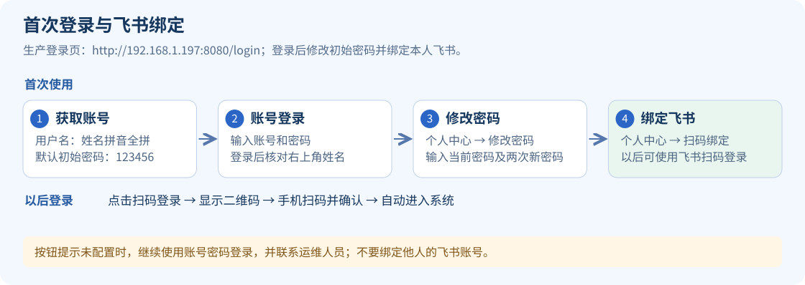

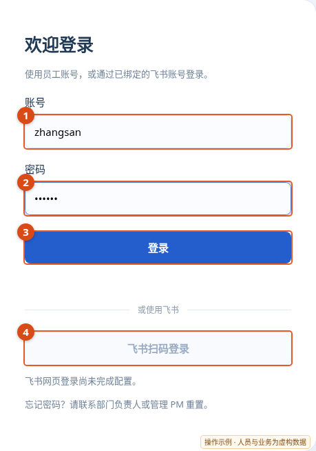

打开上述生产登录页，输入姓名拼音账号和初始密码。登录后核对右上角姓名，并在“个人中心”修改初始密码。已完成绑定的用户可使用④飞书扫码登录，绑定方式见第 3 章。

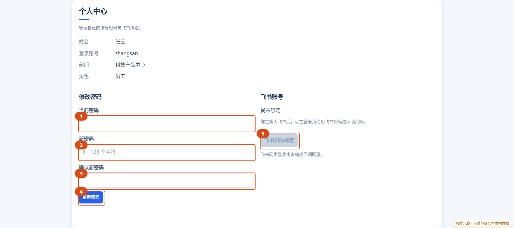

输入当前密码和两次新密码，点击④“更新密码”。修改成功后其他旧会话失效；管理员重置密码会使所有旧会话失效。⑤为飞书绑定入口，未配置扫码能力时不可用。

### 2.3 登录问题处理

- 账号不清楚或忘记密码：联系负责人或管理 PM，在“组织配置 → 岗位与成员”中核对账号或重置密码。
- 连续登录失败受限：按页面提示等待；扫码不可用时，先用账号密码登录，联系运维核查飞书配置。

## 3. 飞书绑定与扫码登录

### 3.1 本人先绑定飞书

1. 先用员工账号和密码登录网页。
2. 打开“个人中心”，查看飞书绑定状态。
3. 点击“飞书扫码绑定”，打开二维码窗口。
4. 用手机上的本人工作飞书“扫一扫”扫描二维码并确认；扫码后如需授权，核对本人工作账号后确认。
5. 核对绑定结果，确认绑定的是本人使用的工作飞书账号。

一个飞书账号只能绑定一名员工。已有绑定冲突、成员选错或需要换绑时，由负责人或管理 PM 在“组织配置 → 飞书成员绑定”中核对并处理。

### 3.2 以后使用飞书扫码登录

1. 打开登录页，点击唯一的“飞书扫码登录”按钮。
2. 窗口始终先显示二维码。用已绑定的手机工作飞书扫码确认；扫码后如需授权，核对本人工作账号后确认。
3. 完成后原页面会自动进入系统，核对右上角姓名再开始工作。

二维码过期时，点击“刷新二维码”；不继续操作时点击“取消”或关闭窗口。浏览器拦截弹窗时，允许本站弹出窗口后重新点击。

电脑已登录飞书或浏览器记住了账号时，也需要先扫码。扫码窗口应在电脑上打开，使用已绑定的手机工作飞书完成验证。

若扫码提示“未绑定”，先用账号密码登录并绑定；若扫码按钮不可用或提示未配置，使用账号密码登录，并联系系统运维人员。绑定飞书后，员工账号密码登录仍可使用。

### 3.3 开通生产智能助手对话

1. 在工作飞书中搜索并打开 **生产-科技产品中心智能助手**。
2. 发送“助手帮助”，查看可以使用的功能。
3. 如果提示未绑定，先完成个人中心绑定；也可请负责人或管理 PM 在“飞书成员绑定”中处理待绑定账号。
4. 再发送“我有哪些任务”，核对返回的任务是否属于本人。

本文后续“智能助手”均指上述生产应用。绑定和对话操作对应本手册中的生产站点。助手按发送消息的飞书账号识别员工身份，不按消息中自称的姓名或职位授予权限。

## 4. 每天从哪里开始

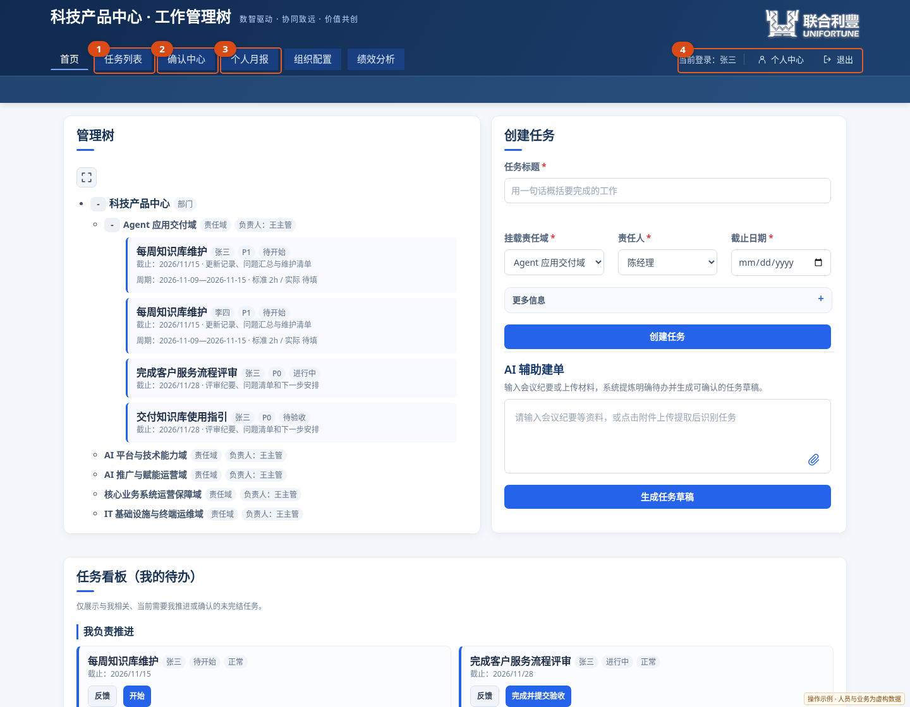

登录后先看④确认身份，再按①查看工作、②处理本人待确认事项、③整理月报。首页管理树按责任域展示工作，下面的任务看板提供开始、反馈和交付入口；负责人登录后还会看到部门周报等管理入口。

| 页面 | 主要用途 |
| --- | --- |
| 首页 | 查看管理树、本人待办或部门关注事项，手工创建任务、AI 辅助建单 |
| 任务列表 | 按状态、责任人、截止月份和关键词查找任务，打开任务详情及历史任务 |
| 确认中心 | 处理新任务确认、进度确认及会话任务草稿 |
| 部门周报 | 管理 PM 和部门负责人整理、审阅、发布部门周报 |
| 个人月报 | 员工生成、编辑、归档自己的月报；管理角色可进入“部门月报”查看员工月报 |
| 组织配置 | 维护岗位成员、确认代理、飞书绑定、责任域和例行任务模板 |
| 绩效分析 | 查看任务交付、时效、质量、工时和过程记录等管理数据 |
| 个人中心 | 查看本人资料、修改密码、绑定飞书 |

员工每天建议先看自己的未完结任务和等待本人验收的事项，再处理临期、逾期或阻塞任务。确认人重点查看“确认中心”和“等待我验收”；管理人员重点查看部门风险、逾期和待验收事项。

管理树展示责任归属及未完结工作。进行中任务在截止日期旁显示已确认进度，待开始任务不显示进度；已完成任务可到任务列表查询。没有看到某个菜单或操作按钮时，先核对本人角色和事项上的责任人、确认人，不要重复创建任务来绕过权限。

### 4.1 任务、待确认事项和草稿的可见范围

| 使用身份 | 可查看的数据 |
| --- | --- |
| 普通成员 | 本人负责的任务、本人需要确认的事项，以及本人创建或负责的草稿 |
| 有实际下属的团队负责人 | 本人及有效汇报关系下的下属任务、待确认事项和草稿；不会向上查看管理 PM、部门负责人的个人待确认事项 |
| 管理 PM、部门负责人 | 部门管理范围内的任务、待确认事项和草稿；确认操作仍按该事项的可确认人执行 |

被明确指定为确认人或代理处理人的人员，可以查看相应事项及其任务证据，不能因此查看该成员的其他无关任务。团队范围依据系统内已生效的直属汇报关系，不根据岗位名称自动扩大。

任务列表、管理树、详情、相似任务搜索、待确认事项和统计使用相同的后台可见范围。知道其他人的任务或确认编号，也不能越权打开详情。首页统计按当前可见数据计算；没有相关数据时显示空清单或零，不会显示部门总数。

草稿创建者、责任人及管理人员可以补充、生成任务或删除草稿；团队负责人查看下属草稿时，若不属于上述身份，页面显示只读。任务转交他人后，原责任人若不再有查看权限，该任务将从原责任人的列表中移除。

## 5. 场景：创建一条明确的工作任务

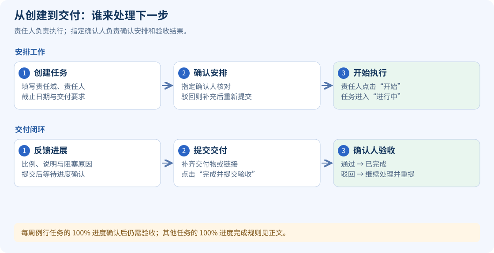

### 5.1 任务类型的区别与使用场景

任务类型表示工作如何组织，不代表优先级，也不按耗时长短划分。

| 类型 | 核心区别 | IT 工作中的典型场景 | 创建方式 |
| --- | --- | --- | --- |
| 专项任务 | 围绕明确目标、范围和交付结果推进的一次性工作，可拆分为阶段任务 | ERP 接口改造、知识库版本升级、系统迁移、性能优化方案实施 | 首页创建任务，在“更多信息”中选择“专项任务” |
| 临时任务 | 按需触发、需要单独处理和交付的一次性事项 | 故障排查与恢复、临时数据核对、一次性权限开通、临时业务支持 | 首页创建任务，在“更多信息”中选择“临时任务” |
| 例行任务 | 内容相对稳定、由明确人员每周重复承担的工作 | 每周系统巡检、备份检查、知识库维护、运维问题汇总 | 管理者在“组织配置 → 例行任务模板”中选择人员、配置工时，由模板按周生成，详见第 10 章 |

**选择顺序：**每周固定重复承担的工作，用例行模板；围绕建设、改造或改进目标推进的工作，选专项；按需发生的一次性处理或支持，选临时。临时任务也可能持续多天或属于 P0，专项任务也可能只需数小时。

例如，同样与备份有关：“每周核查备份结果”属于例行；“处理今天的备份失败”属于临时；“完成备份架构升级与恢复验证”属于专项。巡检发现需要独立跟踪的故障时，可另建临时任务，在详情中说明来源及关联工作。

| 操作差异 | 专项 / 临时任务 | 通过模板生成的每周例行任务 |
| --- | --- | --- |
| 生效与周期 | 按次建单，设置本次截止日期，按指定确认关系生效 | 每周为每名所选员工独立生成，生成即生效，截止为该周日 |
| 标准工时 | 按本次交付范围估算，不能只凭类型判断工作量 | 按每人每周配置；生成后保留当周工时快照，改模板只影响后续任务 |
| 实际工时 | 记录该项工作实际投入 | 填本周累计投入，再次保存替换旧值，不累加 |
| 完成与验收 | 100% 进度确认后可完成；需核对交付物时使用“完成并提交验收” | 100% 进度确认后仍待验收，指定确认人验收通过才完成 |

三类任务都需要唯一责任人、责任域、截止日期和明确交付要求。优先级 P0 / P1 / P2 按事项重要性另行设置；类型也参与绩效计算，具体口径见第 16 章。

当前例行模板按周生成。仅将一条任务或 AI 草稿的类型标记为“例行”，不会自动建立模板或生成后续每周任务。

### 5.2 手工创建

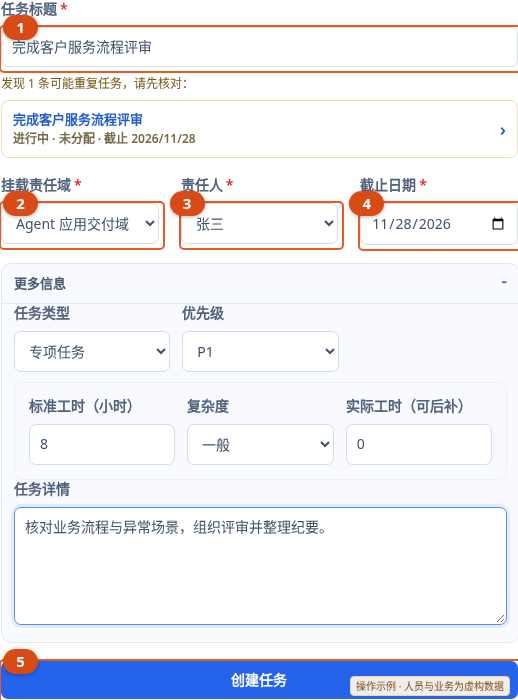

图 6 已展开“更多信息”。先填①—④，再补充任务详情、交付要求及估算工时，点击⑤；提交后按确认事项中的状态继续跟进。截图中相似任务提示表示应先核对已有任务，避免重复建立。

1. 在首页找到“创建任务”。
2. 填写任务标题，说明要交付的结果，例如“完成客户服务流程评审”。
3. 选择归属责任域；没有合适选项时，联系负责人或管理 PM 在“责任域维护”中新增。
4. 选择唯一责任人；内部协同人员不需要全部设为责任人。
5. 选择截止日期。
6. 按需要展开“更多信息”，补充任务详情、交付物或验收标准、优先级、任务类型、标准工时和复杂度。
7. 点击“创建任务”。如出现重复或相似任务提示，先查看已有任务，避免重复安排。
8. 等待确认人核对。通过确认后，任务才成为正式任务。

| 字段 | 操作要点 |
| --- | --- |
| 标题 | 表达一项可交付结果，避免把整段会议记录当标题 |
| 责任域 | 选择工作业务归属，不按员工岗位自动代选 |
| 责任人 | 只选一位最终负责的人 |
| 截止日期 | 填写明确日期，变更时也需更新任务中的日期 |
| 交付物 / 验收标准 | 尽量写清文件、链接、会议结论或可核对的完成条件 |
| 优先级 | P0、P1、P2 按部门实际优先顺序选择 |
| 任务类型 | 按第 5.1 节选择专项或临时；每周固定工作通过例行模板生成 |
| 标准工时与复杂度 | 用于工作量口径和后续分析，填写实际认可的估算 |

### 5.3 为什么创建后找不到任务

草稿和待确认任务不属于正式任务，通常不会进入正式任务列表、管理树和看板。请先在“确认中心”查看是否仍待确认。部门负责人自己的新任务也需要本人在确认中心确认；例行任务由模板生成后直接生效，按例行任务规则处理。

## 6. 场景：把会议纪要或材料转成任务

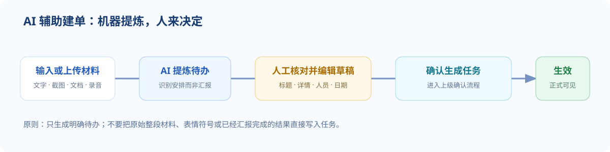

### 6.1 生成与核对 AI 草稿

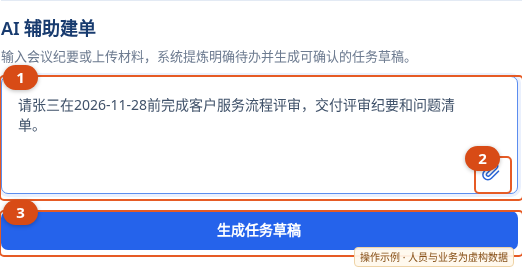

在①输入明确的人员、工作和日期；有材料时点②附件图标，也可按页面提示拖入材料。点③后逐条核对草稿，不要把“已生成草稿”当作“任务已正式生效”。

1. 在首页“AI 辅助建单”中粘贴会议纪要或工作安排。
2. 也可按页面支持的方式添加图片、截图、文档或录音；网页支持拖拽文件、粘贴截图，单个附件不超过 20MB。
3. 等待材料识别完成，再点击“生成任务草稿”。识别过程中不要重复提交同一材料。
4. 一段材料可能提炼出多条草稿，逐条核对标题、详情、责任人、截止日期、责任域、类型、优先级和交付物。
5. 缺少人员、日期或归属时，按提示补充；识别错误时直接修改草稿。
6. 核对无误后点击“确认生成任务”，再由指定确认人完成任务确认。
7. 无效、重复或仅记录已完成结果的草稿可删除。

AI 草稿需要人工核对，任务类型按第 5.1 节确认。材料中的“已经完成”与“安排下一步工作”含义不同，不能仅因为出现了某人姓名和日期就直接生成正式任务。

### 6.2 稍后继续处理草稿

进入“确认中心 → 会话任务草稿”，找到对应草稿，补全后生成或删除。遇到草稿已过期提示时，重新提交材料生成，并先检查是否已有同一任务，避免重复。

若附件无法提取文本、语音未识别或提示能力未配置，可先用文字补充安排，再联系系统运维人员处理识别能力。

## 7. 场景：确认任务和确认进度

### 7.1 确认新任务

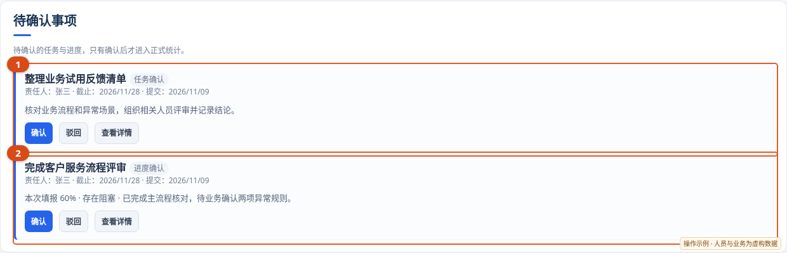

图中同时展示“任务确认”和“进度确认”。点击事项查看对应证据，再使用该事项上的“确认 / 驳回”；确认新任务时核对安排，确认进度时核对本次比例与说明。

| 任务责任人 | 谁可以确认新任务 |
| --- | --- |
| 普通成员 | 该事项指定的上级确认人或有效代理 |
| 管理 PM | 本人或上级部门负责人，保留已指定确认人及有效代理；任意一方处理即可 |
| 部门负责人 | 本人确认；创建后仍需在确认中心核对并确认生效 |

以任务责任人的系统角色判断，和谁创建任务无关。列表与详情会显示“可确认人”；其他管理 PM 不会因管理角色而取得代确认权限。任意一位可确认人确认或驳回后，事项即结束，其他人无需重复处理；系统记录实际操作人和时间。已有待确认任务也按此规则处理，已确认任务保留原记录。

1. 可确认人打开“确认中心”，找到任务确认事项。
2. 点击标题或“查看详情”，核对责任人、责任域、截止日期、优先级、交付物和任务详情。
3. 信息正确时点击“确认”，按弹窗再次核对。
4. 信息不完整或安排不合适时选择“驳回”，写明需要调整的内容。
5. 提交人补充后按页面流程重新提交，确认人再处理。

### 7.2 确认进度

1. 在“确认中心”找到进度确认事项。
2. 查看本次完成比例、进度说明、阻塞原因、预计完成日期及已确认的历史进度。
3. 核对后选择“确认”或“驳回”，驳回时说明问题。
4. 确认通过后，填报进度才成为任务的有效进度。

当前默认规则支持对超过 24 小时仍待确认的进度，在自动运营任务执行时进行“超时自动生效”，记录中会保留标识。它不等同于人工验收，也不适用于所有确认事项；确认人应及时处理自己的待办。

普通成员的进度确认人来自已配置的直属上级、明确确认关系和有效确认代理。管理 PM 的本人任务可以由本人或上级部门负责人确认进度，部门负责人的本人任务可以由本人确认。提交反馈后，仍需在确认中心核对本次比例和说明，再点击确认；不会因本人具备确认权限而自动通过。已有待确认进度也适用，处理时以事项中显示的可确认人为准。

## 8. 场景：执行任务、反馈风险和交付

### 8.1 开始任务并填报进度

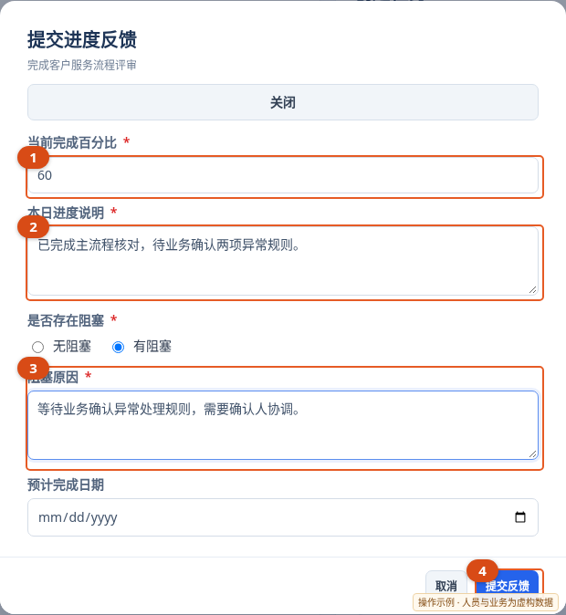

图中示例填写 60%，并选择“有阻塞”。①表示当前累计完成比例；②写清已完成工作；③说明需要谁提供何种支持；点④后到确认中心查看处理结果。未选择阻塞时，不需要填写阻塞原因。

1. 在首页或任务列表打开本人“待开始”任务，先核对要求。
2. 点击“开始”，任务进入“进行中”。
3. 点击“反馈”，输入 0—100 的整数完成比例，并填写进度说明。
4. 有阻塞时选择存在阻塞，填写原因；需要调整计划时补充预计完成日期。
5. 点击“提交反馈”，等待指定确认人处理。
6. 确认后查看任务的有效进度与风险状态。仅提交反馈不表示已经验收。

示例进度说明：“已完成接口联调和异常场景检查；等待业务部门确认两项规则，预计 11 月 12 日补齐。”请填写可核对的进展，而不只写“进行中”。

### 8.2 完成交付并提交验收

交付和验收中的处理人见图 5；本人提交后，下一步由事项显示的指定确认人处理。

1. 在任务中补充最终交付物说明、文件名称或可访问的交付链接。
2. 本人任务处于“进行中”时，点击“完成并提交验收”。
3. 任务进入“待验收”，由页面显示的可验收人处理。管理 PM 可以验收自己的交付，也可以由上级部门负责人验收；部门负责人可以验收自己的交付。
4. 验收通过后任务为“已完成”；被驳回后回到“进行中”，按原因补齐后再提交。

完成方式有两点区别：专项、临时任务通过反馈提交 100% 并经进度确认后，可被标记为已完成；使用“完成并提交验收”则进入人工验收流程。每周例行任务即使 100% 进度已确认，仍进入“待验收”，验收通过后才完成。需要明确核对交付结果的工作，按验收流程操作。

### 8.3 验收交付

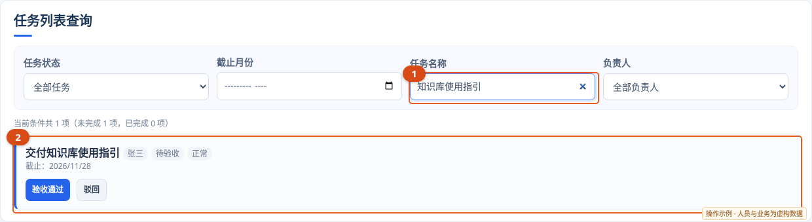

如图先筛选目标任务，打开标题核对交付物；符合要求再点“验收通过”，需要补充时点“驳回”并写明原因。只有该任务的可验收人能看到并执行验收操作，包括符合上述规则的本人。任意一位可验收人处理后，本次验收即结束；系统保留实际验收人、结果和时间。

1. 从“等待我验收”或任务列表找到待验收任务。
2. 核对交付物是否齐全、结果是否符合验收标准，必要时查看详情及进度记录。
3. 达标时点击“验收通过”；不达标时点击“驳回”，写清缺少的材料或需要修改的结果。
4. 确认处理结果，并跟踪责任人后续补充。

普通成员的交付仍由指定确认人验收；管理 PM 和部门负责人处理本人任务时，按上述本人验收规则执行。

## 9. 场景：修改任务、转交工作或删除误建任务

### 9.1 修改任务信息

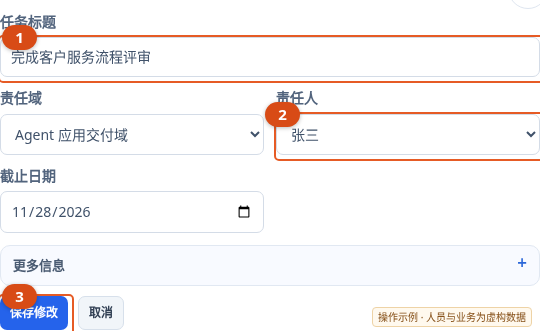

需要转交工作时修改②；仅改内容时保留原责任人。其他字段可在“更多信息”中展开；点击③后返回详情核对新内容。删除误建任务应先退出编辑，在详情中选择“删除任务”并核对确认弹窗。

1. 点击任务标题进入详情，选择“修改任务”。
2. 按需要调整标题、详情、责任域、责任人、截止日期、优先级等可编辑内容。
3. 核对修改内容，点击“保存修改”。
4. 返回任务详情，确认修改已生效；对已安排的工作变更，另行向相关人员说明业务原因。

任务责任人、管理 PM 或部门负责人可按权限修改任务。每周例行任务的标准工时是生成时的模板快照；调整未来任务工时应修改模板，不能直接覆盖已生成任务的该项快照。

### 9.2 转交给另一名责任人

在“修改任务”中更换唯一责任人并保存，再核对新的责任人和确认人。仍待任务确认的事项会按新责任人同步确认链路；如对现有事项的处理人有疑问，以确认中心实际显示为准。

### 9.3 删除误建或重复任务

1. 先查看是否已有进度、确认或验收记录，确认确实需要删除该任务。
2. 在详情中点击“删除任务”。
3. 核对弹窗中的对象并确认。
4. 删除后，当前任务及关联的确认、反馈、进度和验收记录一并移除，审计记录保留。

历史报表可能仍保留此前生成的任务快照。每周例行任务被删除后，本周的原生成记录仍保留，重复“补生成”不会自动重建同一人的这条任务。对已经正式交付的工作，优先通过补充说明和管理处理保留追溯。

## 10. 场景：给多人配置相同或不同的例行工作

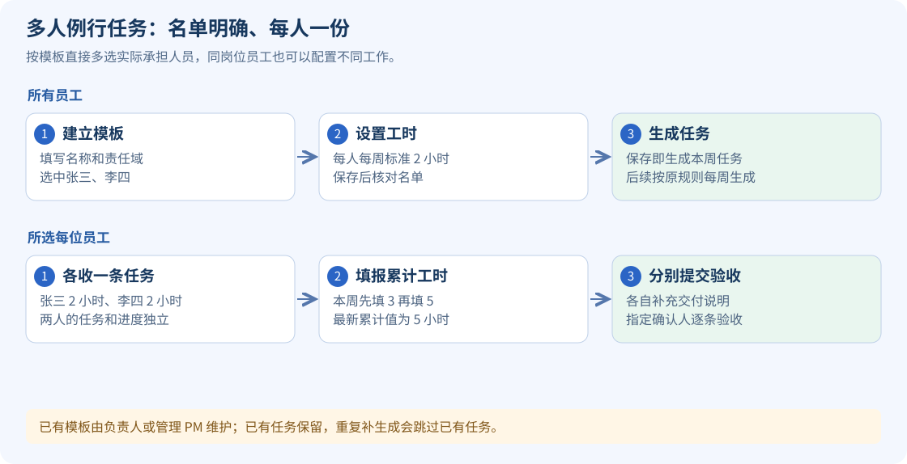

### 10.1 新建例行模板，直接多选人员

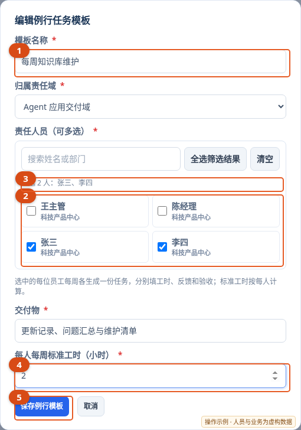

图中同一个“每周知识库维护”模板选中张三、李四，④填 2 小时，表示各生成一条标准 2 小时的任务。点⑤前一定核对③；如果另一项工作只由李四承担，应另建模板并只勾选李四。

负责人或管理 PM 进入“组织配置 → 例行任务模板”：

1. 点击“新增模板”，填写模板名称和归属责任域。
2. 在“责任人员（可多选）”中勾选需要承担这项工作的员工。
3. 人员较多时搜索姓名或部门；“全选筛选结果”会选中当前筛选出的人员，“清空”会清除选择。搜索隐藏已选人员时，不会取消他们的勾选。
4. 核对“已选 N 人”及名单。
5. 填写交付物和“每人每周标准工时”，范围为 0.5—168 小时。
6. 点击保存，返回列表核对模板内容和人员名单。

一个模板为每名选中员工分别生成一条任务。每人有自己的进度、实际工时和验收记录；例如选择 3 人、每人标准工时 2 小时，将分别生成 3 条各 2 小时的任务，不是 3 人共用一条任务或平分 2 小时。

### 10.2 同岗位员工的工作不同，如何选择

按工作内容分别建立模板，再为每个模板选择实际承担的员工。例如“系统巡检”选张三、李四，“知识库维护”只选李四。员工可以被选入多个模板；同一个岗位不代表必须收到相同例行工作。

人员名单由模板明确保存，不随岗位或部门变化自动增加、删除。

### 10.3 自动生成、补生成与增减人员

默认在北京时间每周日 18:00 生成下周一至周日的任务，生成即生效，截止时间为该周日 23:59:59。每个模板、每周、每位选中员工只生成一份。

- 新增人员：编辑模板勾选新员工并保存；需要当周任务时，点击该模板的“补生成本周任务”。
- 重复补生成：已生成的员工会跳过，只补尚未生成的人员。
- 移除人员：编辑模板取消勾选并保存，后续不再为其生成；已经生成的任务保留。
- 调整内容或工时：编辑模板后只影响后续新生成任务，不覆盖已有任务。
- 停用模板：点击“停用”并确认，不再生成新任务，已有任务与历史记录保留。

每个需要定期承担工作的员工，都应在相应模板名单中明确勾选。没有选中人员的模板需先编辑完善，再生成任务。

### 10.4 每周实际工时怎么填

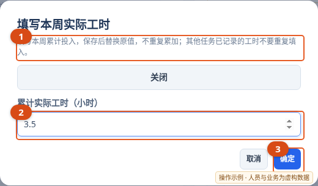

图中②的 3.5 表示本周到目前累计投入 3.5 小时。下一次若累计投入变为 5 小时，填写 5；③保存会替换旧值，不会额外累加。

1. 在本人例行任务卡片或详情中点击“填写本周工时”。
2. 填写该周累计实际投入，允许 0—168 小时。
3. 保存后核对卡片上的“标准 / 实际”工时。
4. 本周继续投入后，再填新的累计数值。

填入 5 小时后再保存 7 小时，结果为 7 小时，不是累加为 12 小时。明确填报 0 小时也会保留填报记录。填写工时不会自动开始、完成或验收任务；责任人、管理 PM 和部门负责人可按权限操作。

## 11. 场景：通过飞书智能助手办事

### 11.1 先分清助手处理方式

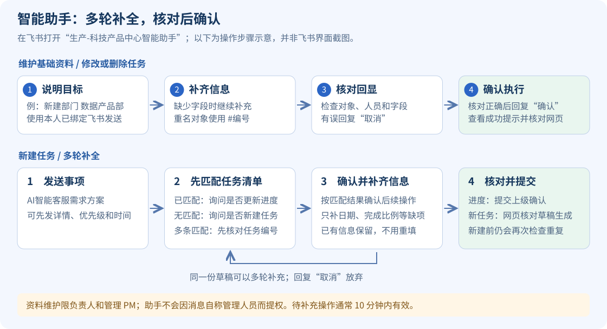

这张图说明对话处理步骤，并非飞书客户端截图。发送“新建部门 数据产品部”后，先看助手回显的对象和字段，正确时回复“确认”；发现错误时回复“取消”再重新说明。查询和任务草稿的后续步骤见下表。

| 输入类型 | 助手如何处理 | 用户下一步 |
| --- | --- | --- |
| 查询待办、团队或部门进展 | 按绑定身份查询并回复 | 核对范围和任务编号 |
| 新建任务安排 | 识别为任务草稿 | 到网页核对草稿并确认生成，再走任务确认 |
| 填报任务进度 | 提交对应任务的进度确认事项 | 等待确认人处理，查看有效进度 |
| 修改、删除、验收、设置代理、维护资料 | 先回显拟操作内容 | 核对后回复“确认”执行，或“取消”放弃 |

涉及对话确认的待执行操作通常 10 分钟内有效。重名成员或资料使用 `#编号` 明确对象；涉及任务时优先使用“任务#编号”。已经确认执行后，不要反复发送相同业务指令。

### 11.2 常用对话示例

以下编号、日期、姓名须替换为实际内容。

| 场景 | 可以发送的话 |
| --- | --- |
| 查看本人工作 | 我有哪些任务 |
| 查看当前待办 | 今天都有哪些任务 |
| 只看今日截止 | 查看部门今天到期的任务 |
| 查看团队 | 汇总团队任务进展 |
| 查看部门，需管理权限 | 查看所有人的任务；汇总部门所有任务进度 |
| 新建任务草稿 | 请张三在2026年11月20日前完成客户服务流程评审，交付评审纪要 |
| 填报进度 | 任务#15 完成60%，阻塞：等待业务确认 |
| 改日期 | 任务#15 截止日期改为2026年11月20日 |
| 改责任人 | 任务#15 责任人改为张三 |
| 修改多个字段 | 任务#15 优先级改为P0，交付物改为评审纪要 |
| 开始工作 | 开始任务#15 |
| 提交交付 | 任务#15 完成并提交 |
| 执行验收 | 验收任务#15 通过 |
| 删除误建任务 | 删除任务#15 |
| 设置确认代理 | 张三代理李四 2026年11月9日至2026年11月13日 |
| 定时汇总 | 每天18:00汇总部门任务进展发给我 |
| 查看完整帮助 | 助手帮助 |

“今天都有哪些任务”等未指定范围的查询，部门负责人和管理 PM 默认查看部门待办，有直属成员的人员默认查看团队待办，其他成员查看本人待办。明确说“我的任务”时，只查本人。普通待办包含当前已生效且未完成的任务；明确说“今天到期”时，才按今日截止日期筛选。助手会显示查询范围、条件和总数，清单较长时提示到网页查看其余任务。

可在同一会话中补充“所有人的”“只看我的”等范围，助手会沿用近期查询的日期和状态条件，并重新校验实际权限。权限以系统中绑定成员的角色为准，自称 PM 不会增加权限。

对“这个任务”“该任务”的理解依赖当前会话，存在多条任务时应明确编号。涉及详细驳回原因或需要逐项核对交付时，建议在网页详情中处理并填写说明。

修改任务时可以分多轮补充，编号支持“任务15”“任务#15”或“#15”。例如先说“修改任务15的责任人”，助手会定位任务并询问新责任人；再回复成员完整姓名或“责任人：#成员编号”，核对回显后回复“确认”才执行。只回复“#15”会继续核对该任务，不会遗忘前面的修改要求。截止日期、标题、详情、交付物和优先级也支持先说明修改目标，再补充新值。

待补充操作在同一会话、同一用户下保留 10 分钟。期间可查询任务，或回复“取消”放弃；提出新的操作会替换原操作。重名成员须用“责任人：#成员编号”明确指定，不能只给一个可能同时指代任务和成员的编号。

也可按下面的格式汇报一项已有任务的进度：

```text
AI智能客服：
1、任务情况：需求调研和方案设计，与业务方持续沟通中
2、优先级：P1
3、计划完成时间：11月30日
4、进度百分比：20%
```

未明确任务编号的事项会先按任务名称和责任人匹配有权访问的任务。找到一项时，助手展示编号、名称和有效进度，并询问是否更新该任务的进度；回复“确认更新”后，沿用前面的情况说明和完成比例提交进度确认。没有提供比例时会继续追问。找到多条同名或相近任务时，先回复编号核对目标，不自动选择其中一项。原汇报内容在同一会话中保留 10 分钟。进度说明中的优先级不会直接修改任务优先级，计划时间作为本次预计完成时间提交确认；调整任务截止日期或优先级须另发明确的修改指令。

任务清单中没有匹配事项时，助手会明确询问“是否新建任务”；回复“确认新建”后，沿用前文内容补全草稿。也可以在内容前加“新建任务”，或随后回复“这是一条新增任务”，该句只用于说明目标，不会当作任务标题。

明确要求新建时仍会检查已有任务。同一责任人的同名或相近任务会先回显核对，不能仅通过更换截止日期来重复新建；已完成、待确认的同名任务会提示当前状态。若确属另一项工作或新阶段，请提供能区分的名称。不同人员承担同类工作按各自责任人区分。飞书草稿在网页确认生成时也会再次核查同一责任人的已有同名任务。

新建任务支持多轮补全，示例过程如下（配合本章开头的流程图阅读）：

| 对话步骤 | 您发送的内容 | 助手如何继续 |
| --- | --- | --- |
| 说明目标 | 新建任务 | 询问任务标题、截止日期等缺失信息 |
| 提供事项 | AI智能客服需求方案 | 保留标题，继续询问缺失的截止日期 |
| 补充时间 | 11月30日 | 回显已知信息，提示资料已补齐 |
| 补充或纠正 | 优先级：P1；任务情况：与业务方沟通中（可分别发送） | 更新原草稿，保留已确认的其他字段 |
| 核对生成 | 到网页“确认中心 → 会话任务草稿”核对并确认生成 | 创建任务并进入原有任务确认流程 |

未指定责任人时，草稿默认由本人负责，并在回显中展示；可继续补充“负责人：成员完整姓名”修改。任务草稿在每次补充后保留 10 分钟，期间可以查询任务后继续补充，或回复“取消”放弃当前草稿。聊天中回复“确认”会再次展示草稿和缺失信息，正式生成仍在网页完成。

匹配到已有任务后，回复“确认更新”即可继续填报进度；也可明确说“更新任务#编号”。需要修改任务字段时，明确说“修改任务资料”，助手会先回显拟变更内容，核对后回复“确认”才执行。

### 11.3 管理人员通过对话维护资料

只有负责人和管理 PM 可以执行以下资料维护。一个指令只维护一个对象，多项字段用逗号分隔，多名责任人员用顿号分隔。

| 要做什么 | 示例 |
| --- | --- |
| 查询资料和编号 | 查看成员；查看部门；查看岗位；查看责任域；查看例行任务模板（分别发送） |
| 新建部门 | 新建部门 数据产品部 |
| 新建岗位 | 新建岗位 数据分析师，部门：数据产品部 |
| 新建成员与账号 | 新建成员 张三，部门：数据产品部，账号：zhangsan |
| 修改成员 | 修改成员 张三，部门：数据产品部，岗位：数据分析师，直属上级：部门管理PM |
| 修改账号 | 修改成员 张三，账号：zhangsan01 |
| 新建责任域 | 新建责任域 数据治理，负责人：张三，边界：数据质量管理 |
| 新建子责任域 | 新建子责任域 数据检查，上级责任域：数据治理 |
| 新建多人例行模板 | 新建例行任务模板 每周检查，责任域：数据治理，责任人员：张三、李四，标准工时：2，交付物：检查记录 |

资料不足时可以继续补充，例如先发送“新建岗位 数据分析师”，再发送“部门：数据产品部”。助手回显后核对完整内容，再回复“确认”。权限或资料发生变化导致操作未执行时，重新说明目标并核对最新内容。

责任域的修改、删除以及需要详细核对的资料维护，使用网页对应模块操作。密码修改使用个人中心，管理员重置使用成员卡片的“重置密码”。

## 12. 场景：维护部门成员、账号和确认关系

岗位和成员资料的新增、修改、删除，以及岗位分配、直属上级调整和员工密码重置，仅部门负责人和管理 PM 可操作。其他用户可查看岗位与成员资料，不显示维护按钮；Team leader 等岗位名称本身不授予管理权限。本人修改密码、绑定本人飞书仍通过“个人中心”办理。

### 12.1 新建岗位和成员

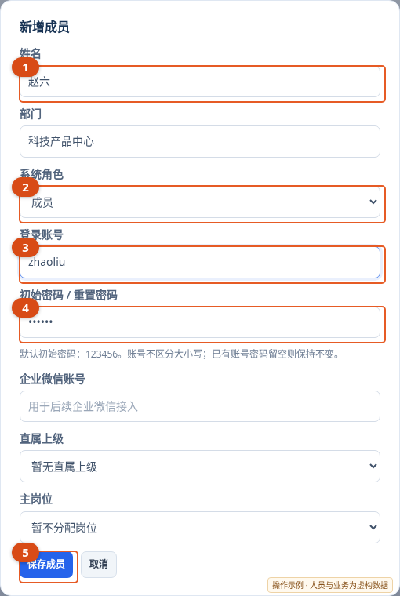

③是发给员工用于登录的账号，不能只填写①姓名就认为账号已开通。②按实际授权选择；普通员工保持“成员”。④若另设密码，要将实际密码单独通知本人；保存后再核对成员卡片上的账号。

由负责人或管理 PM 进入“组织配置 → 岗位与成员”：

1. 需要新岗位时先点击“新增岗位”，填写岗位名称、所属部门、职级并保存。
2. 点击“新增成员”，填写姓名、部门、系统角色和主岗位。
3. 按姓名拼音全拼填写唯一登录账号，字母连写，例如“刘明”填写 `liuming`。重名账号由管理人员确定后单独通知本人。若未另设密码，新账号初始密码使用 `123456`。
4. 核对资料并保存，再查看成员卡片显示的“账号”。
5. 通过公司规定的方式将正式访问地址、本人用户名和初始密码通知该员工，要求首次登录后修改密码。
6. 配置直属上级或默认确认人，告知员工需要向谁提交任务与进度确认。

系统角色与岗位是两项不同配置。为员工选择了某个岗位，不表示其自动获得管理 PM 或部门负责人权限。

### 12.2 修改成员、主岗和直属上级

1. 在成员卡片点击“修改”，调整姓名、部门、角色、直属上级或主岗位并保存。
2. 在“修改成员”的“直属上级”下拉框中选择对应上级；需要单独指定确认人时，由管理人员通过现有汇报关系配置或助手维护。
3. 核对当前成员、主岗及汇报关系显示是否正确。
4. 检查相关人员待办是否需要另行协调，已有事项以实际指定确认人为准。

已有账号的密码留空表示保持原密码，不会重置为默认密码。修改登录账号或设置新密码后，原登录会话可能失效，应通知员工重新登录。员工仍有关联任务时，系统不允许直接删除成员；先核对工作交接和任务处理。

### 12.3 重置员工密码

1. 在成员卡片点击“重置密码”。
2. 核对姓名和登录账号，输入新密码两次。
3. 确认重置，将新密码单独通知本人。
4. 让员工重新登录并修改为本人使用的密码。

尚未配置登录账号的成员，应先配置账号，不能只通过重置密码开通登录。

### 12.4 设置确认代理

1. 进入“组织配置 → 确认代理”，点击新增代理。
2. 选择被代理确认人、代理人、生效开始和结束时间。
3. 核对授权期间并保存。
4. 请代理人查看其实际收到的确认事项。

代理只用于确认授权，不转移任务责任人。已创建事项不一定自动改派，仍以事项上的指定确认人为准；到期后新解析的确认事项按正常关系处理。

## 13. 场景：自定义和维护责任域

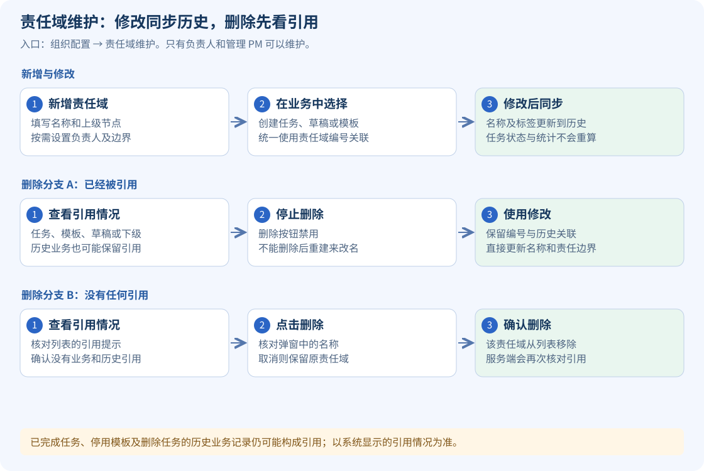

### 13.1 新增责任域

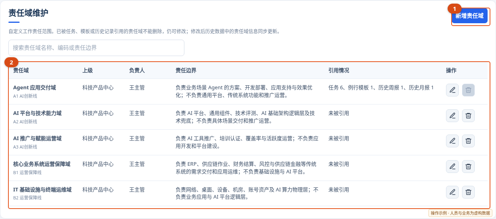

先点①新增；保存后在②核对名称、负责人和责任边界。“已被引用”且删除禁用的行仍可修改，不能通过删除后重建来替代改名。

1. 负责人或管理 PM 进入“组织配置 → 责任域维护”。
2. 点击“新增责任域”，填写名称。
3. 选择上级节点：选择部门节点创建一级责任域，选择已有责任域创建下级责任域。
4. 按需要选择负责人，填写编码、所属条线和责任边界。
5. 保存后核对列表，再到创建任务或例行模板中选择新责任域。

编码可选，支持字母、数字、下划线、点和连字符；名称和编码按系统提示保持唯一。责任边界应写工作范围，不要直接粘贴某一条任务的全部内容。

### 13.2 修改已被引用的责任域

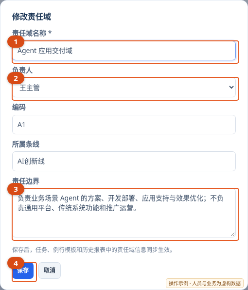

已有业务引用时，可直接改①并点④。等待“历史数据已同步更新”后，再检查旧任务和报表中的责任域名称；不要改动任务来重新关联。

1. 找到责任域并点击“修改”。
2. 调整名称、负责人、编码、所属条线或责任边界。
3. 点击保存，等待历史数据同步完成的提示。
4. 核对任务、模板及需要查看的历史报表。

修改名称后，当前与历史数据继续通过原编号关联责任域；历史周报、月报中的责任域名称及系统生成分组同步更新，包括已发布、已归档版本。任务状态、实际工时、统计数字及人工总结不因标签更新而重新计算或替换。

### 13.3 删除未引用的责任域

先查看列表中的“引用情况”。没有被引用的责任域可点击“删除”并确认。已经被任务、模板、草稿、下级节点、历史报表或历史业务记录引用的责任域不能删除，仍可以修改。

完成、取消的任务或停用模板仍可能构成引用；任务已经删除，其历史业务记录也可能保留引用。删除按钮禁用时，按列表提示维护现有责任域，不要另建同名责任域来替代历史关联。

## 14. 场景：整理、发布和修订部门周报

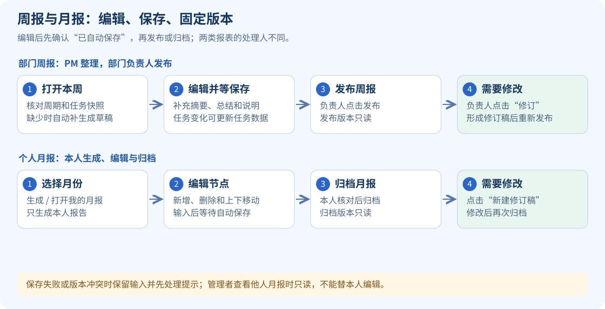

### 14.1 打开本周报告并审阅

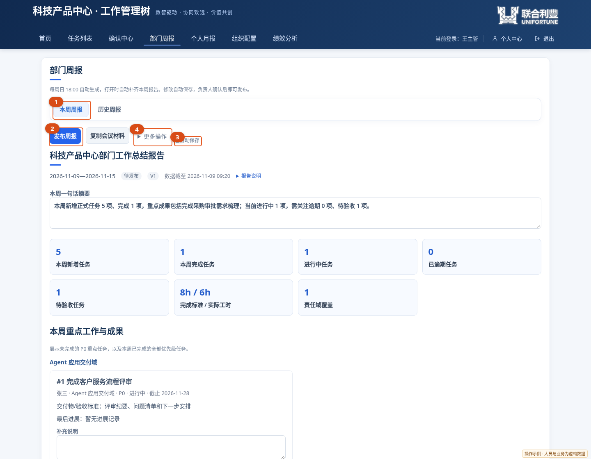

PM 和负责人先核对周期及任务快照，再补充摘要和总结；看到③“已自动保存”后，由负责人点击②。源任务变化时，从④选择“更新任务数据”，再复核材料。管理 PM 账号不会显示负责人专用的发布按钮。

1. 管理 PM 或部门负责人点击“部门周报”。
2. 系统打开本周最新报告；缺少时补生成本周草稿。默认计划生成时间为北京时间每周日 18:00。
3. 核对周期、数据截至时间、任务统计，以及默认按任务编号升序排列的成果、风险及下周重点；责任域保留在任务信息中，不再分组展示。
4. 展开相关任务，核对统计来源。
5. 编辑摘要、总结、要求及支持事项。单项任务的说明直接填写在卡片底部“补充说明”中；用上移、下移调整展示顺序。
6. 等待页面显示“已自动保存”。统计数字由任务快照生成，不能直接手工改数。

任务卡片保留桌面双列、手机单列的紧凑排版，按编号依次展示。责任人、责任域、截止日期和交付标准沿用原有展示；优先级、执行状态及风险关注原因用彩色标签区分，并增加一条已确认进度条。风险区继续查看“风险/最后进展”和“建议动作”，实际的周会结论写入“补充说明”。

进度条使用报告截止时间前的有效进度，未确认的最新填报可能与进度条不同。旧版快照未记录比例时，会自动查找截止时间前已确认的历史进度补齐展示，不改写原快照，无需重新生成周报；历史数据不足时显示灰色轨道及“暂无已确认进度”，不会从说明文字中猜测百分比。纳入报告截止时间之后的新进展，仍需更新草稿的任务数据；已发布版本须先建立修订稿。

### 14.2 报告生成后任务有变化

在待发布报告的“更多操作”中选择“更新任务数据”。系统刷新任务快照，保留人工摘要、总结及有效的条目说明，并提示新增、移除或变化的内容。更新后再核对数据及表述。

### 14.3 发布、查历史和修订

1. 部门负责人完成核对后点击“发布”。管理 PM 可以整理草稿，最终发布由部门负责人执行。
2. 系统先完成最后一次自动保存；保存失败或版本冲突时，先处理提示再发布。
3. 发布后该版本只读，可按年、月、周次查询历史，并复制会议材料文本。
4. 需要修改已发布内容时，负责人点击“修订”，打开独立修订草稿，修改后重新发布。
5. 已存在修订稿时，继续使用已有草稿，不要重复建立版本。

报告的任务事实按快照显示，后续任务变化通常需“更新任务数据”或修订后纳入。责任域基础资料的名称维护会同步历史标签，属于基础资料维护，不是重新计算周报统计。

## 15. 场景：编写、编辑和归档个人月报

### 15.1 生成本人月报

1. 点击“个人月报”，进入“我的月报”。
2. 选择报告月份，点击“生成 / 打开我的月报”。
3. 系统按本人已确认的正式任务生成月度导图，包含月度概览、重点工作与成果、任务进展、风险与阻塞、下月计划和工作总结。
4. 核对姓名、月份和数据截至时间。当前月份统计到生成时刻，已结束月份统计到月末，不能生成未来月份。
5. 重复打开同一月份会打开已有版本，不自动覆盖人工内容。

### 15.2 编辑导图节点

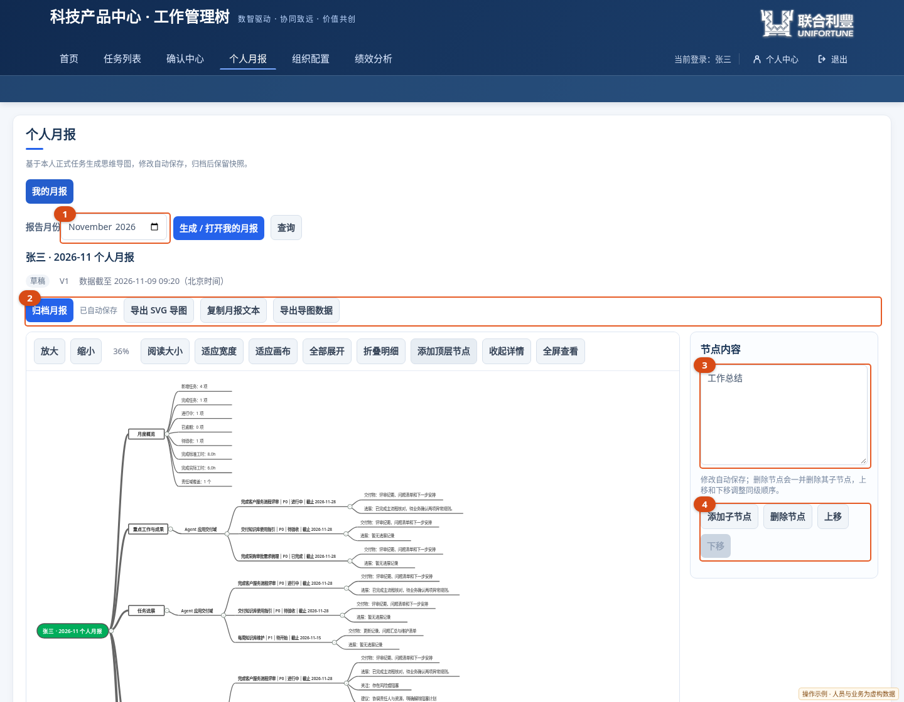

先选①并“生成 / 打开我的月报”，点击导图中的一个节点，再在③编辑文字，或在④调整结构。图中选中了“工作总结”；修改后等“已自动保存”，核对无误再在②归档。统计节点文字不能改，但仍支持④中的结构操作。

点击节点打开“节点详情”。普通文字节点可以编辑内容；标题中的姓名、月份及统计节点文字来自快照，不可直接手工改数。

| 操作 | 具体方法与结果 |
| --- | --- |
| 增加子节点 | 选中任意节点，点击“添加子节点”，再编辑新节点内容；标题、统计节点和主分支也支持增加子节点 |
| 删除节点 | 选中后点击“删除节点”；它的子节点会一并删除，修改会自动保存 |
| 上移 / 下移 | 在同一父节点内调整同级顺序；第一项不能继续上移，最后一项不能继续下移 |
| 增加顶层节点 | 点击导图工具栏“添加顶层节点”，适用于补充独立分支或清空后重新编写 |
| 清空导图 | 删除标题根节点会同时移除其子树；清空后使用“添加顶层节点”继续编写 |
| 查看原任务 | 选择有任务来源的节点，在详情区核对来源任务、责任域和截止日期 |

删除前核对选中的节点及子树范围。修改自动保存，不需要另外寻找保存按钮。

### 15.3 阅读、导出与归档

- 阅读：可使用放大、缩小、阅读大小、适应宽度、适应画布、拖动画布、折叠和全部展开。
- 全屏：点击“全屏查看”，完成后退出全屏或按 Esc。
- 导出：可导出 SVG 导图、导图 JSON 或复制月报文本。
- 归档：核对内容后点击“归档月报”；系统先保存最后一次输入，再固定该版本。
- 修订：已归档版本不能直接编辑，需要点击“新建修订稿”，原归档版本保留。

个人月报仅本人可生成、编辑、归档和修订。负责人和管理 PM 可在“部门月报”中查询员工月报，查看他人月报时只读。

### 15.4 自动保存失败或提示冲突

保留当前页面和输入，先阅读提示。网络恢复后可“重试保存”；提示版本冲突时，先复制需要保留的文字，再“重新加载”并核对最新版本。重新加载会放弃尚未保存的本地输入；不要在未确认保存结果时直接关闭页面或归档。

月报生成后，源任务变化不会自动重写人工导图。若需要在材料中体现变化，按实际情况补充月报或建立修订稿。责任域名称维护会同步历史标签，任务统计和人工总结保留。

## 16. 场景：查看绩效、工时和工作量

### 16.1 先核对数据来源

1. 打开“绩效分析”，选择有权限查看的员工、团队或部门以及周期。
2. 核对统计周期、任务责任人、任务截止日期和正式确认状态。
3. 展开任务明细或证据，检查标准工时、实际工时、复杂度、优先级、完成与验收记录。
4. 数据不符时，先由任务责任人和管理 PM 核对源任务，再处理经授权的口径或校准事项。

当前绩效按正式任务的责任人及截止日期归集周期。未完成工作也可能计入计划工作量，但不会产生已交付的有效绩效点。任务数量不能直接代替交付质量和工作量。

### 16.2 默认绩效点口径

`基准绩效点 = 标准工时 × 复杂度系数 × 优先级系数 × 任务类型系数`

| 项目 | 默认系数 |
| --- | --- |
| 复杂度 | 简单 1.0、一般 1.5、复杂 2.0、重大 3.0 |
| 优先级 | P0 为 1.5、P1 为 1.2、P2 为 1.0 |
| 任务类型 | 例行 1.0、专项 1.2、临时 1.1 |

例如 P1 专项任务，标准工时 8 小时、复杂度为“复杂”，基准绩效点为 `8 × 2.0 × 1.2 × 1.2 = 23.04` 点。

有效交付绩效点在完成条件满足后，结合验收返工和完成时效计算。默认质量系数为：未发生验收驳回 1.0、一次驳回后完成 0.8、多次驳回后完成 0.6；默认时效系数为：按期 1.0、逾期不超过 3 天 0.9、4—7 天 0.75、超过 7 天 0.5。

### 16.3 绩效分与实际工时的区别

绩效分综合交付、质量、时效、过程覆盖及相应角色的团队管理指标，并可包含管理人员按权限进行的人工校准。管理员调整过口径时，以页面当前配置为准。

标准工时用于工作量估算；实际工时用于记录真实投入，不是填得越多分数越高。专项、临时任务的过程记录与进度填报有关；每周例行任务的周工时填报也计入过程记录，明确填报 0 小时仍算一次填报。例行任务只有验收完成后才形成已交付成果。

## 17. 常见问题与处理

| 遇到的情况 | 建议处理 |
| --- | --- |
| 找不到正式系统地址 | 向部门负责人、管理 PM 或系统运维人员获取正式入口 |
| 用姓名或飞书昵称无法登录 | 使用姓名拼音全拼，例如“刘明”输入 `liuming`；重名、多音字或调整过的账号，联系管理 PM 核对实际“登录账号” |
| 默认初始密码不能登录 | 核对是否已改密、被管理员重置或另设初始密码 |
| 飞书扫码提示未绑定 | 先用账号密码登录个人中心完成本人飞书绑定 |
| 已登录但姓名不符 | 退出登录，核对本人账号与绑定关系后重新登录 |
| 看不到任务或任务未出现在树中 | 先查草稿、待确认状态，再核对责任人、筛选条件和完成状态 |
| 提交进度后比例未变化 | 查看是否仍待确认，核对有效进度和填报记录 |
| 没有开始、反馈或验收按钮 | 核对任务状态，以及本人是否为责任人或指定确认人 |
| 助手回复找不到对象 | 使用实际完整名称或任务编号；重名时使用 `#编号` |
| 助手操作没有执行 | 检查是否仍需回复“确认”、操作是否过期、权限或资料是否变化 |
| 新员工没收到例行任务 | 检查模板中是否明确勾选该员工，需要当周任务时补生成 |
| 取消勾选后旧任务仍存在 | 人员选择只影响后续生成，已有任务需单独核对处理 |
| 责任域不能删除 | 查看任务、模板、草稿、下级节点或历史记录引用，按需要修改现有责任域 |
| 周报统计与当前任务不同 | 核对快照截至时间，待发布版本可更新任务数据 |
| 月报数字与最新任务不同 | 核对生成时快照和月份范围，按需要补充文字或修订 |
| 报表提示保存失败或冲突 | 先保留输入，重试保存；冲突时复制必要文字后重新加载 |

## 18. 问题反馈和帮助

需要处理业务安排、归属或确认关系时，先联系直属上级或管理 PM；涉及站点不可达、登录接入、飞书能力等运行问题，由系统运维人员处理。

也可从手册页面或系统入口打开“问题与需求”，选择“问题”或“需求”，填写模块、简要描述、反馈人和影响程度后提交。该页面沿用地址 `/test-issues`，用于日常问题和改进需求登记。

为了方便定位，请提供发生时间、操作入口、任务或报告编号、已执行的步骤、预期结果和实际提示。截图前隐藏密码和不应公开的信息；不要在反馈描述中填写本人密码或他人登录凭据。

## 19. 常用操作速查与账号发放模板

### 19.1 按角色安排日常工作

| 角色 | 建议完成的日常事项 |
| --- | --- |
| 员工 | 登录核对身份 → 查看待办 → 开始或反馈 → 补充交付并提交 → 填本周例行工时 → 核对月报 |
| 确认人 | 查看确认中心 → 核对新任务和进度 → 处理待验收 → 写清驳回原因 → 跟进逾期与阻塞 |
| 管理 PM | 维护成员和确认关系 → 核对责任域与例行人员名单 → 跟踪风险 → 整理周报 → 查看员工月报 |
| 部门负责人 | 督办重点与风险 → 审阅并发布周报 → 核对组织授权和责任边界 → 复盘交付与绩效证据 |

### 19.2 给新员工的账号通知模板

以下模板由负责人或管理 PM 按实际配置填写后，单独发送给该员工。示例用户名不代表已为任何人开通账号。

```text
工作管理树账号开通通知
姓名：本人姓名
正式系统地址：http://192.168.1.197:8080/
登录页：http://192.168.1.197:8080/login
生产飞书智能体：生产-科技产品中心智能助手
登录用户名：本人姓名拼音全拼，例如刘明为 liuming（填写实际开通账号）
初始密码：未另设时为 123456；如已另设，填写实际通知的初始密码
首次登录：核对姓名 → 个人中心修改密码 → 绑定本人工作飞书
默认确认人：直属上级或实际指定确认人
使用手册：http://192.168.1.197:8080/manual（需先登录）
业务问题联系人：部门管理 PM
运行问题联系人：公司系统运维联系人
```
